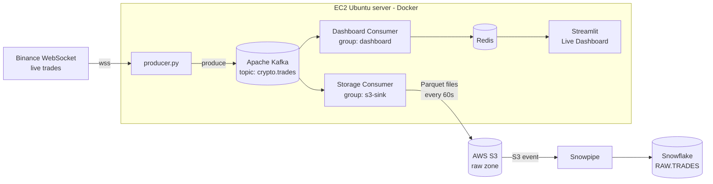

# Real-time Crypto Trade Data Pipeline

A beginner-friendly, end-to-end **streaming data engineering project**.

Live cryptocurrency trades from **Binance** flow through **Apache Kafka** into two places at the same time:

1. A **live dashboard** that updates every 2 seconds
2. **AWS S3** (as Parquet files), which **Snowflake** loads automatically for analytics

Everything runs on **one AWS EC2 Ubuntu server** using Docker.

---

## Table of Contents

- [Architecture](#architecture)
- [What You Will Learn](#what-you-will-learn)
- [Key Terms (Read This First)](#key-terms-read-this-first)
- [Tech Stack](#tech-stack)
- [Project Structure](#project-structure)
- [Before You Start](#before-you-start)
- [Step 1 — Set Up the EC2 Server](#step-1--set-up-the-ec2-server)
- [Step 2 — Run Kafka with Docker](#step-2--run-kafka-with-docker)
- [Step 3 — Producer: Binance → Kafka](#step-3--producer-binance--kafka)
- [Step 4 — Storage Consumer: Kafka → S3](#step-4--storage-consumer-kafka--s3)
- [Step 5 — Snowpipe: S3 → Snowflake](#step-5--snowpipe-s3--snowflake)
- [Step 6 — Live Dashboard](#step-6--live-dashboard)
- [Daily Use: Start, Stop, Check](#daily-use-start-stop-check)
- [Troubleshooting](#troubleshooting)
- [Design Decisions](#design-decisions)
- [Cost](#cost)
- [Roadmap](#roadmap)

---

## Architecture



**In plain words:**

1. `producer.py` listens to Binance and sends every trade into Kafka.
2. Kafka stores the trades and lets **two independent readers** use them.
3. The **storage consumer** saves trades to S3 every 60 seconds.
4. S3 tells Snowflake "a new file arrived," and **Snowpipe** loads it into a table.
5. The **dashboard consumer** keeps the latest numbers in Redis, and **Streamlit** shows them in your browser.

---

## What You Will Learn

- Reading real-time data from a WebSocket API
- Running Apache Kafka yourself (no managed service)
- Writing reliable Kafka producers and consumers in Python
- Storing data in a data lake (S3) as Parquet
- Loading data into Snowflake automatically with Snowpipe
- Building a live dashboard
- Handling failures: reconnects, crashes, bad messages and duplicates

---

## Key Terms (Read This First)

| Term | Simple meaning |
|---|---|
| **WebSocket** | A connection that stays open so a server can *push* data to you continuously (unlike a normal web request). |
| **Apache Kafka** | A system that stores a stream of messages in order, so many programs can read them. Think of it as a very fast, durable message log. |
| **Broker** | One running Kafka server. We run one. |
| **KRaft** | Kafka's built-in way of managing itself. (Older Kafka needed a separate tool called ZooKeeper; modern Kafka doesn't.) |
| **Topic** | A named stream of messages, like a table. Ours is `crypto.trades`. |
| **Partition** | A topic is split into partitions so work can be shared. We use 3. |
| **Message key** | A label on each message. Messages with the same key always go to the same partition and stay in order. Our key is the coin symbol, e.g. `BTCUSDT`. |
| **Producer** | A program that **writes** messages into Kafka. |
| **Consumer** | A program that **reads** messages from Kafka. |
| **Consumer group** | A name for a team of consumers. Each group keeps its own reading position, so two groups can read the same data independently. |
| **Offset** | A message's position number inside a partition. |
| **Commit** | A consumer telling Kafka "I've finished up to this offset." |
| **Lag** | How many messages a consumer group has not processed yet. Small lag = healthy. |
| **DLQ (Dead Letter Queue)** | A separate topic where broken messages are parked so they don't stop the pipeline. Ours is `crypto.trades.dlq`. |
| **Parquet** | A compressed, column-based file format. Much smaller and faster to query than CSV or JSON. |
| **S3 bucket** | A storage container in AWS for files. |
| **IAM role** | A set of AWS permissions given to a service (like EC2 or Snowflake) instead of using passwords or access keys. |
| **Snowflake stage** | Snowflake's pointer to a folder in S3. |
| **Storage integration** | A secure link that lets Snowflake read your S3 bucket using an IAM role. |
| **Snowpipe** | A Snowflake feature that loads new files automatically as soon as they land in S3. |
| **Redis** | A very fast in-memory store. We use it to hold the latest numbers for the dashboard. |
| **Streamlit** | A Python library that turns a script into a web dashboard. |
| **tmux** | A tool that keeps programs running on the server after you close your SSH window. |
| **SSH tunnel** | A secure way to open a web page that runs on the server in your own browser, without exposing it to the internet. |

---

## Tech Stack

| Layer | Tool |
|---|---|
| Data source | Binance WebSocket (public trade stream, no API key needed) |
| Server | AWS EC2, Ubuntu 24.04 |
| Streaming | Apache Kafka (official `apache/kafka` Docker image, KRaft mode) |
| Kafka UI | Kafka UI (web interface to see topics and messages) |
| Language | Python 3 |
| Data lake | AWS S3 (Parquet) |
| Data warehouse | Snowflake + Snowpipe |
| Live store | Redis |
| Dashboard | Streamlit + Plotly |

---

## Project Structure

```
crypto-pipeline/
├── infra/
│   ├── docker-compose.yml       # Kafka, Kafka UI and Redis
│   └── .env                     # your private settings (NEVER commit this)
├── producer/
│   ├── ws_test.py               # Step 1: tests the Binance connection
│   └── producer.py              # Step 3: Binance -> Kafka
├── consumers/
│   ├── storage_consumer.py      # Step 4: Kafka -> S3
│   └── dashboard_consumer.py    # Step 6: Kafka -> Redis
├── dashboard/
│   └── app.py                   # Step 6: Streamlit dashboard
├── snowflake/
│   └── setup.sql                # Step 5: all Snowflake SQL
├── .gitignore
└── README.md
```

---

## Before You Start

You need:

- An **AWS account**
- A **Snowflake account** (a free trial works; choose **AWS → Asia Pacific (Mumbai)** as the region if possible)
- An **SSH key pair** (`.pem` file) to log in to EC2
- Basic comfort with copying commands into a terminal

### Values you will collect along the way

Keep a notepad open. Whenever this guide shows a value in `CAPITALS`, replace it with your own:

| Placeholder | What it is | Where you get it |
|---|---|---|
| `YOUR_KEY.pem` | Your SSH key file | Created when you launch EC2 |
| `YOUR_EC2_PUBLIC_DNS` | Your server's public address, e.g. `ec2-13-x-x-x.ap-south-1.compute.amazonaws.com` | EC2 Console → your instance → **Public IPv4 DNS** |
| `YOUR_BUCKET` | Your S3 bucket name | You choose it in Step 4 |
| `YOUR_AWS_ACCOUNT_ID` | Your 12-digit AWS account number | Step 5 shows how |

> **Tip:** attach an **Elastic IP** to your EC2 (EC2 → Elastic IPs → Allocate → Associate). Without it, your public address **changes every time you stop and start the server**, and you'll have to update `.env`.

---

## Step 1 — Set Up the EC2 Server

**Goal:** a server with Docker and Python, and confirmation that it can reach Binance.

### 1.1 Launch the EC2 instance

In the AWS Console → **EC2 → Launch instance**:

| Setting | Value | Why |
|---|---|---|
| Region | **ap-south-1 (Mumbai)** | Close to South Asia; Binance blocks some regions (especially US) |
| OS image | **Ubuntu Server 24.04 LTS** | Stable, long support |
| Instance type | **t3.large** (2 CPU, 8 GB RAM) | Kafka needs memory; 4 GB is too small |
| Storage | **30 GB gp3** | Room for Kafka data and Docker images |
| Security group | Allow **SSH (port 22)** from **My IP** only | Never open the server to the whole internet |

### 1.2 Connect to the server

On your computer:

```bash
ssh -i YOUR_KEY.pem ubuntu@YOUR_EC2_PUBLIC_DNS
```

### 1.3 Install the basic tools

Run these one by one:

```bash
sudo apt update && sudo apt upgrade -y
```

```bash
sudo apt install -y python3-venv python3-pip git curl unzip jq
```

Install Docker:

```bash
curl -fsSL https://get.docker.com | sudo sh
```

Allow your user to run Docker without `sudo`:

```bash
sudo usermod -aG docker $USER
newgrp docker
```

Check that everything is installed:

```bash
docker --version
docker compose version
python3 --version
```

✅ Each command prints a version number.

### 1.4 Create the project folders

```bash
mkdir -p ~/crypto-pipeline/infra ~/crypto-pipeline/producer ~/crypto-pipeline/consumers ~/crypto-pipeline/dashboard ~/crypto-pipeline/snowflake
cd ~/crypto-pipeline
```

### 1.5 Create a Python virtual environment

A **virtual environment** keeps this project's Python libraries separate from the rest of the system.

```bash
python3 -m venv .venv
source .venv/bin/activate
pip install --upgrade pip
pip install websocket-client
```

> Every time you open a new terminal, run `cd ~/crypto-pipeline && source .venv/bin/activate` first.

### 1.6 Test the Binance connection

Copy `producer/ws_test.py` from this repo into the same place on your server, then run:

```bash
python producer/ws_test.py
```

✅ At least one line starts with `OK` and shows a BTC price.

❌ If both lines say `FAIL` with `451` or `403`, Binance is blocking your server's region. Launch the server in a different region.

---

## Step 2 — Run Kafka with Docker

**Goal:** Kafka running in Docker, with its data saved safely, plus a web UI to look inside it.

### 2.1 Create the settings file `.env`

This file holds private settings. Docker Compose and the Python scripts read it.

First, generate a unique ID for your Kafka cluster:

```bash
docker run --rm apache/kafka:latest /opt/kafka/bin/kafka-storage.sh random-uuid
```

It prints something like `MkU3OEVBNTcwNTJENDM2Qk`. Copy it.

Now create the file:

```bash
cd ~/crypto-pipeline/infra
nano .env
```

Type these two lines, using your own values:

```
EC2_PUBLIC_DNS=YOUR_EC2_PUBLIC_DNS
KAFKA_CLUSTER_ID=PASTE_THE_ID_YOU_COPIED
```

Save with **Ctrl+O**, press **Enter**, then exit with **Ctrl+X**.

> **Using nano:** Ctrl+O = save, Ctrl+X = exit. We use this for every file.

### 2.2 Create `docker-compose.yml`

Copy `infra/docker-compose.yml` from this repo into `~/crypto-pipeline/infra/`.

It starts three services:

| Service | What it does | Address |
|---|---|---|
| `kafka` | The Kafka broker | `kafka:9092` (inside Docker), `YOUR_EC2_PUBLIC_DNS:29092` (for Python scripts) |
| `kafka-ui` | Web page to see topics and messages | `localhost:8080` (through an SSH tunnel) |
| `redis` | Live store for the dashboard (used in Step 6) | `localhost:6379` |

Check the file for mistakes before starting:

```bash
docker compose config --quiet && echo "FILE OK"
```

✅ You see `FILE OK`.

### 2.3 Start Kafka and Kafka UI

```bash
docker compose up -d kafka kafka-ui
```

Check the status (wait about 30 seconds):

```bash
docker compose ps
```

✅ `kafka` shows **(healthy)** and `kafka-ui` shows **running**.

### 2.4 Create the topics

The main topic, for trades:

```bash
docker exec kafka /opt/kafka/bin/kafka-topics.sh --bootstrap-server kafka:9092 --create --topic crypto.trades --partitions 3 --replication-factor 1
```

The dead letter queue, for broken messages (kept for 7 days):

```bash
docker exec kafka /opt/kafka/bin/kafka-topics.sh --bootstrap-server kafka:9092 --create --topic crypto.trades.dlq --partitions 1 --replication-factor 1 --config retention.ms=604800000
```

List all topics:

```bash
docker exec kafka /opt/kafka/bin/kafka-topics.sh --bootstrap-server kafka:9092 --list
```

✅ You see `crypto.trades` and `crypto.trades.dlq`.

### 2.5 Test Kafka by hand

We use a separate test topic so test messages never mix with real trades.

```bash
docker exec kafka /opt/kafka/bin/kafka-topics.sh --bootstrap-server kafka:9092 --create --topic test.topic --partitions 1 --replication-factor 1
```

Open **two terminals** connected to the server.

**Terminal 1** — the reader (it waits for messages):

```bash
docker exec -it kafka /opt/kafka/bin/kafka-console-consumer.sh --bootstrap-server kafka:9092 --topic test.topic
```

**Terminal 2** — the writer:

```bash
docker exec -it kafka /opt/kafka/bin/kafka-console-producer.sh --bootstrap-server kafka:9092 --topic test.topic
```

At the `>` prompt, type `hello` and press Enter.

✅ `hello` appears in Terminal 1.

Press **Ctrl+C** in both terminals, then delete the test topic:

```bash
docker exec kafka /opt/kafka/bin/kafka-topics.sh --bootstrap-server kafka:9092 --delete --topic test.topic
```

### 2.6 Check that Python scripts will be able to connect

Our Python scripts connect through port `29092`. Install a small Kafka tool called `kcat` and test it:

```bash
sudo apt install -y kcat
kcat -b YOUR_EC2_PUBLIC_DNS:29092 -L
```

✅ You see a line like `broker 1 at ec2-...amazonaws.com:29092`.

❌ If it shows `kafka:9092` or freezes, check `EC2_PUBLIC_DNS` in your `.env`.

### 2.7 Check that data survives a restart

```bash
docker compose down
docker compose up -d kafka kafka-ui
```

Wait 30 seconds, then list the topics again:

```bash
docker exec kafka /opt/kafka/bin/kafka-topics.sh --bootstrap-server kafka:9092 --list
```

✅ Both topics are still there. (This works because Kafka's data is stored in a Docker **volume**.)

### 2.8 Open Kafka UI in your browser

On **your own computer** (not the server), open an SSH tunnel:

```bash
ssh -i YOUR_KEY.pem -L 8080:localhost:8080 ubuntu@YOUR_EC2_PUBLIC_DNS
```

Open **http://localhost:8080** in your browser.

✅ You see your Kafka cluster and topics.

---

## Step 3 — Producer: Binance → Kafka

**Goal:** a Python program that receives live trades from Binance and sends each one to Kafka.

### 3.1 Install the libraries

```bash
cd ~/crypto-pipeline
source .venv/bin/activate
pip install confluent-kafka python-dotenv
```

- `confluent-kafka` — a fast, reliable Kafka library for Python
- `python-dotenv` — reads settings from the `.env` file

### 3.2 Add the producer code

Copy `producer/producer.py` from this repo to `~/crypto-pipeline/producer/`.

**What it does:**

- Connects to Binance for **BTCUSDT, ETHUSDT and SOLUSDT** trades
- Turns Binance's short field names (`p`, `q`, `T`) into clear names (`price`, `quantity`, `trade_time`)
- Sends each trade to Kafka with the **coin symbol as the key**
- **Reconnects automatically** if the connection drops (waiting 1s, 2s, 4s… up to 60s)
- Logs a **GAP** warning if any trades were missed during a reconnect
- Waits until Kafka confirms each message is stored (`acks=all`), and never sends duplicates when retrying (`enable.idempotence`)

> If only `stream.binance.com` worked in Step 1, change the `WS_HOST` line in `producer.py` to `wss://stream.binance.com:9443`.

### 3.3 Run it

```bash
python producer/producer.py
```

✅ Every 10 seconds you see a line like:

```
INFO sent=812 failed=0 gaps=0 waiting=3
```

### 3.4 Check the data in Kafka

In a second terminal:

```bash
docker exec kafka /opt/kafka/bin/kafka-console-consumer.sh --bootstrap-server kafka:9092 --topic crypto.trades --from-beginning --property print.key=true --max-messages 5
```

✅ You see 5 trades like:

```
BTCUSDT  {"symbol": "BTCUSDT", "trade_id": 5123456789, "price": "76012.45000000", ...}
```

### 3.5 Failure test: stop Kafka while the producer runs

```bash
cd ~/crypto-pipeline/infra
docker compose stop kafka
```

Wait 20 seconds. In the producer window, `waiting=` grows (messages are held in memory). Then:

```bash
docker compose start kafka
```

✅ After about 30 seconds, `waiting` drops back near 0 and `failed=0`. Nothing was lost.

### 3.6 Keep it running in the background

Stop the producer with **Ctrl+C**. ✅ It prints `Stopped. ... unsent=0`.

Now start it inside **tmux** so it keeps running after you log out:

```bash
tmux new -s producer
```

Inside tmux:

```bash
cd ~/crypto-pipeline && source .venv/bin/activate && python producer/producer.py
```

Leave tmux (the program keeps running): press **Ctrl+B**, release, then press **D**.

> **tmux basics:** `tmux ls` = list sessions · `tmux attach -t producer` = go back in · **Ctrl+B then D** = leave without stopping

---

## Step 4 — Storage Consumer: Kafka → S3

**Goal:** save every trade to S3 as Parquet files, without losing data even if the program crashes.

**How it stays safe:** the consumer collects trades for 60 seconds, uploads them to S3, and **only then** tells Kafka "done." If it crashes before uploading, it simply re-reads those trades on restart.

### 4.1 Create the S3 bucket

AWS Console → **S3 → Create bucket**:

| Setting | Value |
|---|---|
| Region | `ap-south-1` (same as your EC2) |
| Bucket name | Must be unique worldwide, e.g. `crypto-trades-raw-yourname-2026` → this is `YOUR_BUCKET` |
| Block all public access | ✅ ON |
| Encryption | SSE-S3 (default) |

### 4.2 Give your EC2 permission to write to the bucket

We use an **IAM role** instead of access keys, so no passwords are stored on the server.

**Create the role:**

1. **IAM → Roles → Create role**
2. Trusted entity: **AWS service → EC2** → Next
3. Skip the permissions page → Next
4. Name: `crypto-pipeline-ec2-role` → **Create role**

**Add permissions:** open the role → **Add permissions → Create inline policy → JSON**, and paste this (replace `YOUR_BUCKET` in **both** places):

```json
{
  "Version": "2012-10-17",
  "Statement": [
    {
      "Effect": "Allow",
      "Action": ["s3:PutObject", "s3:GetObject"],
      "Resource": "arn:aws:s3:::YOUR_BUCKET/raw/*"
    },
    {
      "Effect": "Allow",
      "Action": "s3:ListBucket",
      "Resource": "arn:aws:s3:::YOUR_BUCKET"
    }
  ]
}
```

Name it `crypto-raw-s3-write` → **Create policy**.

**Attach the role to your server:** EC2 → select your instance → **Actions → Security → Modify IAM role** → choose `crypto-pipeline-ec2-role` → **Update IAM role**.

### 4.3 Install the AWS CLI and test access

```bash
cd ~
curl "https://awscli.amazonaws.com/awscli-exe-linux-x86_64.zip" -o awscliv2.zip
unzip -q awscliv2.zip
sudo ./aws/install
aws --version
```

Check which identity the server is using:

```bash
aws sts get-caller-identity
```

✅ The `Arn` contains `crypto-pipeline-ec2-role`.

Test uploading a file:

```bash
echo "test" > test.txt
aws s3 cp test.txt s3://YOUR_BUCKET/raw/test.txt
aws s3 ls s3://YOUR_BUCKET/raw/
aws s3 rm s3://YOUR_BUCKET/raw/test.txt
```

✅ `test.txt` is listed, then removed.

### 4.4 Add the bucket to `.env`

```bash
cd ~/crypto-pipeline/infra
nano .env
```

Add two lines at the bottom:

```
S3_BUCKET=YOUR_BUCKET
AWS_REGION=ap-south-1
```

Your `.env` now has **4 lines**: `EC2_PUBLIC_DNS`, `KAFKA_CLUSTER_ID`, `S3_BUCKET`, `AWS_REGION`.

### 4.5 Install the libraries

```bash
cd ~/crypto-pipeline
source .venv/bin/activate
pip install boto3 pyarrow
```

- `boto3` — the AWS library for Python (uploads to S3)
- `pyarrow` — creates Parquet files

### 4.6 Add the storage consumer code

Copy `consumers/storage_consumer.py` from this repo to `~/crypto-pipeline/consumers/`.

**What it does:**

- Reads from `crypto.trades` as consumer group **`s3-sink`**
- Collects trades for **60 seconds** (or 50,000 trades, whichever comes first)
- Writes one Parquet file per coin per hour folder, for example:
  `raw/trades/symbol=BTCUSDT/dt=2026-11-08/hour=08/part-....parquet`
- **Commits to Kafka only after the S3 upload succeeds**
- Sends broken messages to the DLQ topic instead of crashing
- Retries failed uploads 5 times; if S3 is still failing, it stops **without** committing, so no data is lost

### 4.7 Run it

Make sure the producer is still running (`tmux ls` shows `producer`). Then:

```bash
python consumers/storage_consumer.py
```

✅ About every 60 seconds:

```
INFO Flushed 4210 records into 3 files, committed. Totals: files=6 records=...
```

### 4.8 Check the files in S3

```bash
aws s3 ls s3://YOUR_BUCKET/raw/trades/ --recursive | tail -5
```

✅ You see `.parquet` files inside `symbol=.../dt=.../hour=...` folders.

Check how far behind the consumer is:

```bash
docker exec kafka /opt/kafka/bin/kafka-consumer-groups.sh --bootstrap-server kafka:9092 --describe --group s3-sink
```

✅ The `LAG` column stays small (it grows for up to 60 seconds, then drops after each upload).

### 4.9 Crash test

Force-kill the consumer (this simulates a crash):

```bash
pkill -9 -f storage_consumer.py
```

Wait 30 seconds, then start it again (Step 4.7).

✅ The first upload is bigger (it catches up), then `LAG` goes back to small. **No data was lost.** (A few trades may be saved twice; Snowflake handles duplicates later.)

### 4.10 Keep it running

Stop it with **Ctrl+C** (✅ prints `Stopped cleanly.`), then:

```bash
tmux new -s storage
```

```bash
cd ~/crypto-pipeline && source .venv/bin/activate && python consumers/storage_consumer.py
```

Press **Ctrl+B**, then **D**.

---

## Step 5 — Snowpipe: S3 → Snowflake

**Goal:** every new Parquet file in S3 is loaded into a Snowflake table automatically, within about a minute.

> Run all the SQL below in a **Snowflake worksheet** (Snowsight → Projects → Worksheets → **+**). Save it as `snowflake/setup.sql` in your repo too.

### 5.1 Create the warehouse, database and schema

```sql
USE ROLE SYSADMIN;

CREATE WAREHOUSE IF NOT EXISTS CRYPTO_WH
  WAREHOUSE_SIZE = XSMALL
  AUTO_SUSPEND = 60
  AUTO_RESUME = TRUE
  INITIALLY_SUSPENDED = TRUE;

CREATE DATABASE IF NOT EXISTS CRYPTO_DB;
CREATE SCHEMA IF NOT EXISTS CRYPTO_DB.RAW;

USE WAREHOUSE CRYPTO_WH;
SELECT CURRENT_REGION();
```

- **Warehouse** = the compute that runs your queries. `AUTO_SUSPEND = 60` turns it off after 60 seconds of no use, so you don't pay while idle.
- The last query shows your Snowflake region. `AWS_AP_SOUTH_1` is ideal (same as your bucket).

### 5.2 Create a read-only IAM role for Snowflake (AWS Console)

Find your AWS account ID. On the server:

```bash
aws sts get-caller-identity --query Account --output text
```

This 12-digit number is `YOUR_AWS_ACCOUNT_ID`.

**Create the role:**

1. **IAM → Roles → Create role**
2. Trusted entity type: **AWS account → This account**
3. Tick **Require external ID** and type `0000` (a temporary value; we replace it in 5.4)
4. Next → skip permissions → Next
5. Name: `snowflake-crypto-raw-read` → **Create role**

**Add read-only permissions:** open the role → **Add permissions → Create inline policy → JSON** (replace `YOUR_BUCKET` in both places):

```json
{
  "Version": "2012-10-17",
  "Statement": [
    {
      "Effect": "Allow",
      "Action": ["s3:GetObject", "s3:GetObjectVersion"],
      "Resource": "arn:aws:s3:::YOUR_BUCKET/raw/trades/*"
    },
    {
      "Effect": "Allow",
      "Action": ["s3:ListBucket", "s3:GetBucketLocation"],
      "Resource": "arn:aws:s3:::YOUR_BUCKET",
      "Condition": { "StringLike": { "s3:prefix": ["raw/trades/*"] } }
    }
  ]
}
```

Name it `snowflake-read-raw-trades` → **Create policy**.

### 5.3 Create the storage integration (Snowflake)

Replace `YOUR_AWS_ACCOUNT_ID` and `YOUR_BUCKET`:

```sql
USE ROLE ACCOUNTADMIN;

CREATE STORAGE INTEGRATION S3_CRYPTO_RAW_INT
  TYPE = EXTERNAL_STAGE
  STORAGE_PROVIDER = 'S3'
  ENABLED = TRUE
  STORAGE_AWS_ROLE_ARN = 'arn:aws:iam::YOUR_AWS_ACCOUNT_ID:role/snowflake-crypto-raw-read'
  STORAGE_ALLOWED_LOCATIONS = ('s3://YOUR_BUCKET/raw/trades/');

GRANT USAGE ON INTEGRATION S3_CRYPTO_RAW_INT TO ROLE SYSADMIN;

DESC INTEGRATION S3_CRYPTO_RAW_INT;
```

From the `DESC` result, **copy these two values**:

- `STORAGE_AWS_IAM_USER_ARN`
- `STORAGE_AWS_EXTERNAL_ID`

### 5.4 Allow Snowflake to use the role (AWS Console)

IAM → Roles → `snowflake-crypto-raw-read` → **Trust relationships → Edit trust policy**. Replace everything with this, pasting in your two values:

```json
{
  "Version": "2012-10-17",
  "Statement": [
    {
      "Effect": "Allow",
      "Principal": { "AWS": "PASTE_STORAGE_AWS_IAM_USER_ARN" },
      "Action": "sts:AssumeRole",
      "Condition": {
        "StringEquals": { "sts:ExternalId": "PASTE_STORAGE_AWS_EXTERNAL_ID" }
      }
    }
  ]
}
```

Click **Update policy**.

### 5.5 Create the stage and test it (Snowflake)

```sql
USE ROLE SYSADMIN;
USE WAREHOUSE CRYPTO_WH;
USE SCHEMA CRYPTO_DB.RAW;

CREATE FILE FORMAT IF NOT EXISTS PARQUET_FF TYPE = PARQUET;

CREATE STAGE IF NOT EXISTS TRADES_STAGE
  URL = 's3://YOUR_BUCKET/raw/trades/'
  STORAGE_INTEGRATION = S3_CRYPTO_RAW_INT
  FILE_FORMAT = PARQUET_FF;

LIST @TRADES_STAGE;
```

✅ Your Parquet files are listed.

❌ `Access Denied` → re-check the two values you pasted in 5.4.

Look inside the files:

```sql
SELECT $1 FROM @TRADES_STAGE LIMIT 3;
```

### 5.6 Create the raw table

```sql
CREATE TABLE IF NOT EXISTS TRADES (
  SYMBOL           VARCHAR,
  TRADE_ID         NUMBER(38,0),
  PRICE            VARCHAR,          -- kept as text for now (exact value)
  QUANTITY         VARCHAR,
  TRADE_TIME       NUMBER(38,0),     -- time of trade, in milliseconds
  EVENT_TIME       NUMBER(38,0),
  IS_BUYER_MAKER   BOOLEAN,
  INGESTED_AT      NUMBER(38,0),
  KAFKA_PARTITION  NUMBER(10,0),
  KAFKA_OFFSET     NUMBER(38,0),
  SOURCE_FILE      VARCHAR,          -- which S3 file this row came from
  FILE_ROW_NUMBER  NUMBER(38,0),
  LOADED_AT        TIMESTAMP_LTZ DEFAULT CURRENT_TIMESTAMP()
);
```

### 5.7 Create the pipe

```sql
CREATE PIPE IF NOT EXISTS TRADES_PIPE
  AUTO_INGEST = TRUE
AS
COPY INTO TRADES (
  SYMBOL, TRADE_ID, PRICE, QUANTITY, TRADE_TIME, EVENT_TIME,
  IS_BUYER_MAKER, INGESTED_AT, KAFKA_PARTITION, KAFKA_OFFSET,
  SOURCE_FILE, FILE_ROW_NUMBER
)
FROM (
  SELECT
    $1:symbol::STRING,
    $1:trade_id::NUMBER,
    $1:price::STRING,
    $1:quantity::STRING,
    $1:trade_time::NUMBER,
    $1:event_time::NUMBER,
    $1:is_buyer_maker::BOOLEAN,
    $1:ingested_at::NUMBER,
    $1:kafka_partition::NUMBER,
    $1:kafka_offset::NUMBER,
    METADATA$FILENAME,
    METADATA$FILE_ROW_NUMBER
  FROM @TRADES_STAGE
)
FILE_FORMAT = (FORMAT_NAME = 'PARQUET_FF');

SHOW PIPES LIKE 'TRADES_PIPE';
```

From the `SHOW PIPES` result, **copy the `notification_channel` value**. It looks like `arn:aws:sqs:ap-south-1:...:sf-snowpipe-...`.

### 5.8 Make S3 notify Snowflake (AWS Console)

S3 → your bucket → **Properties** → **Event notifications** → **Create event notification**:

| Field | Value |
|---|---|
| Event name | `snowflake-trades` |
| Prefix | `raw/trades/` |
| Suffix | `.parquet` |
| Event types | ✅ All object create events |
| Destination | **SQS queue** → **Enter SQS queue ARN** → paste the `notification_channel` value |

Click **Save changes**.

### 5.9 Load the files that already exist

Notifications only cover *new* files. Load the older ones once:

```sql
ALTER PIPE TRADES_PIPE REFRESH;
```

> This is safe to run any time. Snowpipe remembers which files it has already loaded and skips them.

### 5.10 Check that it works

Wait 2 minutes, then check the pipe:

```sql
SELECT SYSTEM$PIPE_STATUS('CRYPTO_DB.RAW.TRADES_PIPE');
```

✅ It shows `"executionState":"RUNNING"`.

See the data arriving:

```sql
SELECT
  SYMBOL,
  COUNT(*)                              AS ROWS_LOADED,
  TO_TIMESTAMP_LTZ(MAX(TRADE_TIME), 3)  AS LATEST_TRADE,
  MAX(LOADED_AT)                        AS LAST_LOAD
FROM TRADES
GROUP BY SYMBOL
ORDER BY SYMBOL;
```

✅ One row per coin. Run it again a minute later, and `ROWS_LOADED` grows.

Check for load errors:

```sql
SELECT FILE_NAME, ROW_COUNT, STATUS, FIRST_ERROR_MESSAGE, LAST_LOAD_TIME
FROM TABLE(INFORMATION_SCHEMA.COPY_HISTORY(
  TABLE_NAME => 'CRYPTO_DB.RAW.TRADES',
  START_TIME => DATEADD(hour, -1, CURRENT_TIMESTAMP())))
ORDER BY LAST_LOAD_TIME DESC
LIMIT 10;
```

✅ `STATUS` = `Loaded`, no error message.

Check for duplicate trades:

```sql
SELECT
  COUNT(*)                                     AS TOTAL_ROWS,
  COUNT(DISTINCT SYMBOL, TRADE_ID)             AS UNIQUE_TRADES,
  COUNT(*) - COUNT(DISTINCT SYMBOL, TRADE_ID)  AS DUPLICATES
FROM TRADES;
```

Zero or a small number is fine. Duplicates are removed in Step 7.

---

## Step 6 — Live Dashboard

**Goal:** a web page showing live prices, 1-minute candles and recent trades, updating every 2 seconds.

**How it works:** a second consumer (group **`dashboard`**) keeps the latest numbers in **Redis**, and **Streamlit** reads Redis to draw the page.

### 6.1 Start Redis

Redis is already in `docker-compose.yml`. Start it:

```bash
cd ~/crypto-pipeline/infra
docker compose up -d redis
docker exec redis redis-cli ping
```

✅ You see `PONG`.

### 6.2 Install the libraries

```bash
cd ~/crypto-pipeline
source .venv/bin/activate
pip install redis streamlit plotly
```

- `redis` — talks to Redis from Python
- `streamlit` — builds the web dashboard
- `plotly` — draws the candlestick chart

### 6.3 Add the dashboard consumer

Copy `consumers/dashboard_consumer.py` from this repo to `~/crypto-pipeline/consumers/`.

**What it does:**

- Reads from `crypto.trades` as consumer group **`dashboard`**, starting from **now** (not old data)
- Builds **1-minute candles** (open, high, low, close, volume) for each coin
- Saves the latest price, the last 50 trades and the last 3 hours of candles in Redis
- Writes a **heartbeat** every loop, so the dashboard can tell if it stopped

Run it:

```bash
python consumers/dashboard_consumer.py
```

✅ Every 10 seconds: `processed=1534 skipped=0`

Check Redis in a second terminal:

```bash
docker exec redis redis-cli hgetall latest:BTCUSDT
```

✅ You see the latest BTC price, side and latency.

Check that both consumer groups exist:

```bash
docker exec kafka /opt/kafka/bin/kafka-consumer-groups.sh --bootstrap-server kafka:9092 --list
```

✅ You see `s3-sink` and `dashboard`.

### 6.4 Add the dashboard page

Copy `dashboard/app.py` from this repo to `~/crypto-pipeline/dashboard/`.

Run it:

```bash
cd ~/crypto-pipeline && source .venv/bin/activate
streamlit run dashboard/app.py --server.address 127.0.0.1 --server.port 8501 --server.headless true
```

### 6.5 Open the dashboard in your browser

On **your own computer**, open a tunnel for both the dashboard and Kafka UI:

```bash
ssh -i YOUR_KEY.pem -L 8501:localhost:8501 -L 8080:localhost:8080 ubuntu@YOUR_EC2_PUBLIC_DNS
```

Open **http://localhost:8501**.

✅ You see a green **Live** bar, the price, trades per minute, VWAP (volume-weighted average price), latency, a candlestick chart and a recent-trades table.

### 6.6 Failure tests

**Test 1: dead consumer detection.** Stop `dashboard_consumer.py` with **Ctrl+C**.
✅ Within 10 seconds, the dashboard shows a **red "stale"** warning.

**Test 2: the two consumers are independent.** While the dashboard consumer is stopped:

```bash
docker exec kafka /opt/kafka/bin/kafka-consumer-groups.sh --bootstrap-server kafka:9092 --describe --group s3-sink
```

✅ `s3-sink` lag is still small. S3 and Snowflake keep working even when the dashboard is down.

Start the dashboard consumer again. ✅ The bar turns green.

### 6.7 Keep everything running

```bash
tmux new -s dashcons
```

```bash
cd ~/crypto-pipeline && source .venv/bin/activate && python consumers/dashboard_consumer.py
```

Press **Ctrl+B**, then **D**.

```bash
tmux new -s dashboard
```

```bash
cd ~/crypto-pipeline && source .venv/bin/activate && streamlit run dashboard/app.py --server.address 127.0.0.1 --server.port 8501 --server.headless true
```

Press **Ctrl+B**, then **D**.

```bash
tmux ls
```

✅ You see 4 sessions: `producer`, `storage`, `dashcons`, `dashboard`.

---

## Daily Use: Start, Stop, Check

### Start everything (after the server restarts)

```bash
cd ~/crypto-pipeline/infra
docker compose up -d
```

Then start the 4 Python programs in tmux (Steps 3.6, 4.10 and 6.7). **Start the producer first.**

> If you don't use an Elastic IP, update `EC2_PUBLIC_DNS` in `infra/.env` first, then run `docker compose up -d` again.

### Stop everything

Stop each Python program: `tmux attach -t NAME`, press **Ctrl+C**, then type `exit`. Stop them in this order: `producer` first, then `storage`, `dashcons`, `dashboard`.

Then stop Docker:

```bash
cd ~/crypto-pipeline/infra
docker compose down
```

> Never use `docker compose down -v`. The `-v` deletes Kafka's saved data.

### Quick health check

| What to check | Command | Healthy result |
|---|---|---|
| Containers | `docker compose ps` (in `infra/`) | kafka **healthy**, others **running** |
| Python programs | `tmux ls` | 4 sessions |
| S3 consumer lag | `docker exec kafka /opt/kafka/bin/kafka-consumer-groups.sh --bootstrap-server kafka:9092 --describe --group s3-sink` | LAG small |
| Newest S3 files | `aws s3 ls s3://YOUR_BUCKET/raw/trades/ --recursive \| tail -3` | timestamps from the last minute |
| Memory | `free -h` | several GB available |

---

## Troubleshooting

| Problem | Likely cause | Fix |
|---|---|---|
| `451` or `403` when connecting to Binance | Your server's region is blocked | Use the other Binance address, or launch EC2 in another region (e.g. ap-south-1) |
| `docker compose` error: `volumes.redis additional properties ... not allowed` | The `redis:` block was pasted under `volumes:` instead of under `services:` | Move it above the `volumes:` line. Check with `docker compose config --quiet` |
| `kcat -L` shows `kafka:9092` or freezes | Wrong address in `.env` | Fix `EC2_PUBLIC_DNS` in `infra/.env`, then `docker compose up -d` |
| Python scripts can't reach Kafka after the server restarts | Public DNS changed (no Elastic IP) | Update `.env`, run `docker compose up -d`, restart the scripts |
| `aws sts get-caller-identity` fails | IAM role not attached to EC2 | EC2 → Actions → Security → Modify IAM role |
| Snowflake `LIST @TRADES_STAGE` → Access Denied | Trust policy values are wrong | Re-run `DESC INTEGRATION` and re-paste both values (Step 5.4) |
| Snowflake table not growing | S3 event notification is missing or wrong | Check prefix `raw/trades/`, suffix `.parquet`, and the SQS ARN. Run `ALTER PIPE TRADES_PIPE REFRESH;` |
| Dashboard shows red "stale" warning | `dashboard_consumer.py` stopped | `tmux attach -t dashcons` and restart it |
| Kafka UI stops showing data after Kafka restarts | UI lost its connection | `docker compose restart kafka-ui` |
| Producer shows `GAP ... missed N trades` | Connection dropped briefly | Expected and logged on purpose; the live stream can't replay missed trades |

---

## Design Decisions

| Decision | Why |
|---|---|
| **Self-hosted Apache Kafka** (not a managed service) | Full control and learning value; no extra service cost |
| **KRaft mode** | Modern Kafka doesn't need ZooKeeper; one fewer component |
| **Coin symbol as message key** | Keeps every coin's trades in order |
| **Prices kept as text** until Snowflake | Avoids rounding errors that floats cause with money |
| **Two consumer groups** | The dashboard and storage never slow each other down |
| **S3 consumer commits only after upload** (at-least-once) | No data loss on crash; duplicates are removed later |
| **Dashboard consumer starts from latest** (at-most-once) | A live view needs "now," and skipping a few trades on restart is harmless |
| **Parquet + `symbol/dt/hour` folders** | Small files that are fast to query; tools can skip folders they don't need |
| **IAM roles, no access keys** | Nothing secret stored on the server or in Snowflake |
| **Snowpipe auto-ingest** | Data appears in Snowflake about a minute after it lands in S3, with no scheduler |
| **Ports bound to `127.0.0.1` + SSH tunnel** | Kafka UI, Redis and the dashboard have no login, so they're never exposed to the internet |

**Known limits (this is a single-server project):**

- One Kafka broker with no copies. If the server's disk is lost, unsaved trades are lost too. A production setup would run 3 Kafka brokers on separate servers.
- Trades sent by Binance while the producer is reconnecting are missed. They're logged as `GAP`, and could be backfilled from Binance's REST API.

---

## Cost

Approximate, for the ap-south-1 region:

| Item | Cost |
|---|---|
| EC2 t3.large | ~$0.09 per hour (**stop it when not in use**) |
| EBS 30 GB | ~$2.5 per month |
| S3 storage + uploads | under $1 per month |
| Snowpipe | Tiny (charged per GB loaded; Parquet is small) |
| Snowflake warehouse | Only while you run queries; turns off after 60 seconds idle |

---

## Roadmap

- [x] Step 1 — EC2 setup and Binance connection test
- [x] Step 2 — Kafka (KRaft) + Kafka UI with Docker
- [x] Step 3 — Producer: Binance → Kafka
- [x] Step 4 — Storage consumer: Kafka → S3 (Parquet)
- [x] Step 5 — Snowpipe: S3 → Snowflake
- [x] Step 6 — Live dashboard (Redis + Streamlit)
- [ ] Step 7 — dbt models in Snowflake: remove duplicates, 1-minute OHLC candles, VWAP, volume
- [ ] Step 8 — Hardening: run as services, monitoring, alerts, cost controls

---

## Important: Don't Commit Secrets

Create a `.gitignore` file in the project root with:

```
.venv/
infra/.env
*.pem
__pycache__/
*.parquet
awscliv2.zip
aws/
```

`infra/.env` contains your server address and bucket name, and `.pem` is your login key. **Never push these to GitHub.**
